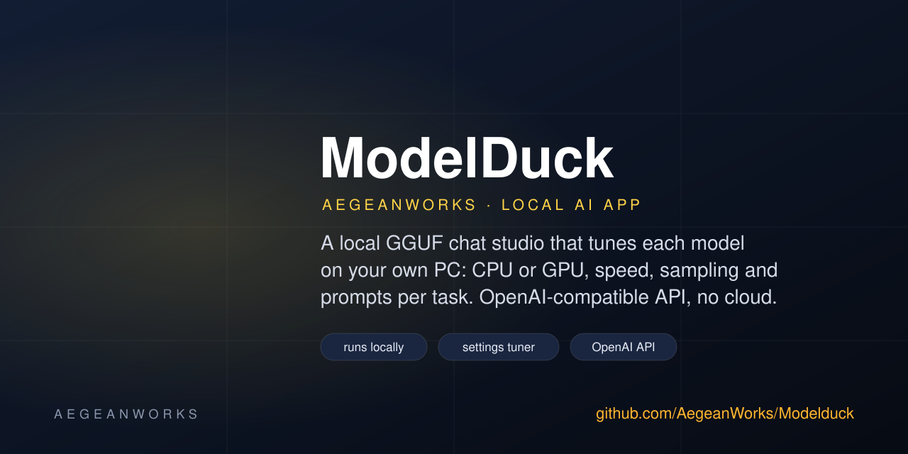
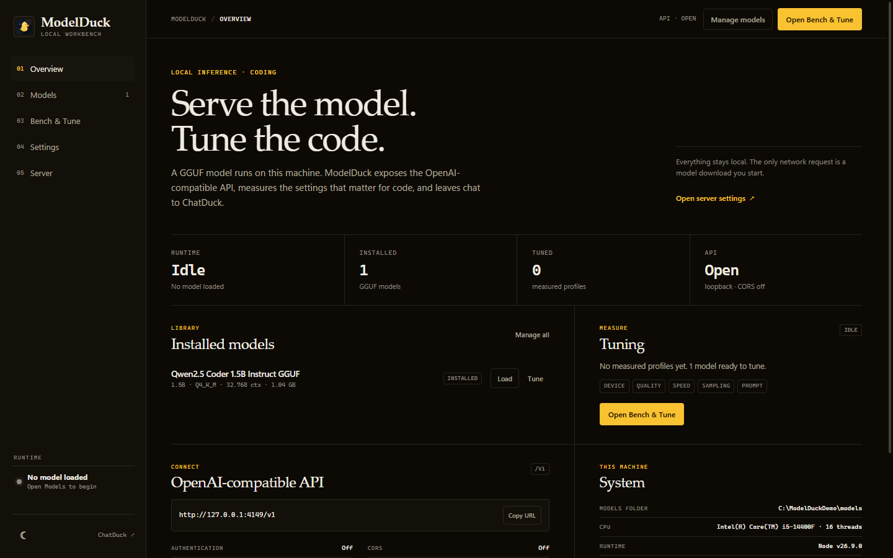
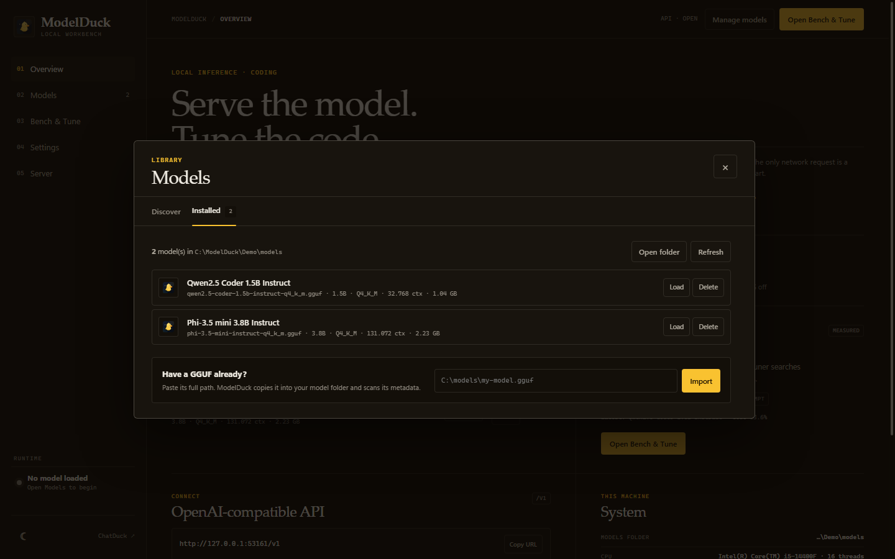

# ModelDuck

<!-- aegean:media:start -->
<p align="center"></p>
<p align="center"><a href="LICENSE"></a> <a href="https://github.com/AegeanWorks/AIKit"></a></p>
<!-- aegean:media:end -->


A local GGUF model server and coding-model tuner: load a model, serve an OpenAI-compatible API, and tune it for code.
Runs on the CPU or a Vulkan GPU; no cloud account, no telemetry. Weights, prompts and settings stay on your
computer; the only network requests are model downloads you start (the inference
runtime is never downloaded or built on demand). The tuner measures quality per
second and per GB on your machine, so a preset is evidence, not a guess.

The chat UI lives in [**ChatDuck**](https://github.com/AegeanWorks/Chatduck), a
separate static client for any OpenAI-compatible server. ModelDuck keeps the
server and the tuning control panel: Models, Bench & Tune, Settings and Server.

## 30-Second Cold-Start Quick Reference

- **Runtime Prerequisites**: Node.js 20 or newer, 8 GB RAM, and a modern browser.
  Windows 10/11 is the tested platform; macOS and Linux use the same commands.
- **Model folder override**: `MODELDUCK_MODELS=D:\Models` or `--models D:\Models`.
- **Data folder override**: `MODELDUCK_HOME=D:\ModelDuckData` or `--home D:\ModelDuckData`.
- **Canonical Regression Shield Gate**:
  ```bash
  npm test
  ```
- **AI Tune Shield Gate** (G-001):
  ```bash
  npm run tune:gate
  ```
  Re-measures the three core models' baseline settings per task and fails when a
  task loses more than one item; `npm run tune:gate -- --update-baseline` re-tunes
  them deliberately. The cross-model comparison (`npm run bench`, `bench:all`,
  `bench:full`) is optional and never gates. Use `npm run bench -- --download`
  once for models.

### First run

1. Double-click **`start.bat`** (Windows) or run:
   ```bash
   npm install
   npm start
   ```
   The first run installs `node-llama-cpp` and its prebuilt CPU runtime.
2. ModelDuck opens at **http://127.0.0.1:4141**. On Windows it uses an installed
   Edge or Chrome to open a standalone app window; otherwise it opens your default
   browser. Closing that window does not stop the local server; press **Ctrl+C**
   in the terminal to quit.
3. Click **Models → Discover**, download a starter model, then **Install → Load**.
4. Open **Bench & Tune → Tune** to optimize the model, or **Models → Load** to serve it.
   Chat lives in ChatDuck; point it at `http://127.0.0.1:4141`.

No model is bundled. A good first pick is **Qwen2.5 0.5B Instruct** (469 MB,
fast) or **Qwen2.5 1.5B Instruct** (1.1 GB, better answers on a 16 GB machine).

### AIKit Commands (run from the AIKit folder)

| Role | Command |
|---|---|
| Status, task and gates | `python aikit.py status modelduck` |
| Phase 4: every gate | `python aikit.py check modelduck` |
| Repair memory and map, then check | `python aikit.py fix modelduck` |
| Resume an interrupted task | `python aikit.py resume modelduck` |

### Useful commands

```bash
npm start -- --port 4141 --no-open
npm start -- --home D:\ModelDuckData --models D:\Models
npm run dev                  # restart on source changes
npm test                     # hermetic unit + integration tests
npm run ui:smoke             # headless control-panel and dialog check
npm run tune -- --model qwen2.5-0.5b-instruct-q4   # tune one model (reuses a saved profile)
npm run tune -- --model <id> --tasks code,comprehension --force   # re-tune chosen tasks
npm run tune -- --model <id> --interactive   # choose every setting's steps first
npm run tune -- --model <id> --stages quality,speed   # run some stages; the rest stay default
npm run tune -- --model <id> --stages device   # about a minute: does it run faster on the GPU?
npm run tune -- --model <id> --settings contextSize,threads   # re-tune only these settings
npm run tune:gate            # re-measure the core models' baseline settings (G-001)
```

`MODELDUCK_GPU=auto npm start` lets `node-llama-cpp` use a detected CUDA/Vulkan/Metal
device. It is off by default so a missing driver never prevents local inference from working.

## What you get

- **Model library** — scan a folder, import a GGUF by path, or download a curated
  model from Hugging Face, checked against a pinned SHA-256, with resumable `.part`
  downloads (a repeated start reuses the running download).
- **Model controls** - context size, CPU threads and thread pool, batch size,
  context sequences, GPU backend/layers, KV cache, checkpoint interval and max,
  flash attention, mmap, temperature, top-p/top-k/min-p, repeat penalty, max reply tokens, system
  prompt, reasoning, context overflow, structured output and prompt repetition,
  saved in `settings.json`.
- **OpenAI-compatible API** — `GET /v1/models`, `GET /v1/models/:id`,
  `POST /v1/chat/completions` and `POST /v1/completions`, including SSE
  streaming, so local tools can use ModelDuck as a drop-in backend.
- **Chat lives in ChatDuck** — the separate static client at
  https://github.com/AegeanWorks/Chatduck speaks the same `/v1` API. ModelDuck's
  own page is a control panel for Models, Bench & Tune, Settings and Server.
- **Benchmark** — its own tab and gate: run either phase and read per-test rates;
  older-suite reports appear only when asked.
- **Settings tuner** - **Bench & Tune → Tune** finds the best settings for each installed
  model, in order: device (CPU or GPU, measured, with a partial offload when the
  full one will not fit), context (largest that
  fits in free memory) and KV cache, speed settings (threads, batch, flash, mmap), then sampling and prompt per task (code, comprehension, long context). A setting changes only on a clear paired gain (Holm-corrected), a value that falls significantly behind stops early, each preset is checked on unseen items, and a model that cannot load stops the tune. A re-tune skips items no earlier setting has flipped. Profiles export and import as checked recipes, and clearly worse question types are named. For code, it tries coding directives, searches on our own items, and keeps every coding view in mind.
  Each step is saved and applied, so a
  tune can stop anywhere, a stage or task can run again alone, a table names
  each task's best model, and
  **Run all** tunes models in CPU and GPU lanes, live;
  **Runs** keeps every run and answer; stopped runs continue. **Tune
  settings** edits the values each setting is tried at and the lanes for this PC. **Benchmark** lists each task's question types and checks.
  Stages run Device → Quality → Speed → Sampling → Prompt: Quality sets the context and KV cache first so Speed is measured on the final load shape.
  **Recommended for this PC** ranks installed models by measured answers and speed, then catalog estimates.
  The client chooses a preset per task with `x-modelduck-task`; **Settings** has the tuned on/off switch
  and Fastest/Light/Quiet. A collapsible **How tuning works** section in Tune explains the five stages, the
  increasing rungs, the clear-gain rule, the held-back check and what tuning does not do. Tune with heavy programs closed.
- **Small surface area** — Node's HTTP server and a vanilla UI; no build or CDN.
- **AI benchmark gate** - two phases: model reload/quantization/KV-cache settings,
  then sampling/prompting settings, with test hashes so test edits show.

## AI benchmark gate

The required gate is `npm run tune:gate` (ADR-027). This seeded, batch-1
cross-model benchmark on the real `LlamaEngine` is optional: the **model reload**
phase (`npm run bench`) changes one load setting at a time across models, and the
**model usage** phase (`npm run bench:chat`) compares sampling and prompting on a
chosen configuration.

The default set is SmolLM2 135M, Qwen2.5 0.5B and Qwen2.5 Coder 1.5B. `--full-matrix` / `npm run bench:full`
adds Qwen2.5 1.5B, Llama 3.2 3B and Phi-3.5 Mini with KV-cache variants (hours on a CPU). Suite v14 runs 262 items: 242
questions ModelDuck authored for code, multi-file codebases, bug fixes, code comprehension and long-context recall, plus 20 public
HumanEval and MBPP tasks. No other tasks are part of the suite;
see [benchmarks/NOTICE-benchmarks.md](benchmarks/NOTICE-benchmarks.md). Public items
may be in a model's training data, so the report shows **own questions** and
**public benchmarks** apart, with public results per dataset.

```bash
npm run bench -- --download        # first run: fetch missing models, core phase
npm run bench:all                  # optional: add the model-usage phase
npm run bench:full                 # optional: add Llama 3B and Phi 3.8B
npm run bench -- --model <id>      # settings sweep for one model; never touches a baseline
npm run bench:update               # deliberately replace both baselines
npm run bench:update:model         # deliberately replace only the model baseline
npm run bench:update:full          # replace the model baseline with six models
npm run bench:report
npm run bench:link                 # after commit: attach the run to HEAD
```

The model-usage phase only changes sampling and prompting, so run it when those change; a
model-only baseline update leaves the model-usage baseline on its previous suite. Run
`npm run bench:all` when both phases must describe the same suite.

A model-phase recommendation can become the chat base without rerunning the model
phase. **Use for chat** in the Bench panel, or `npm run bench -- --select-base
<variantId>`, writes `benchmarks/chat-base.json`; the next model-usage phase loads that
measured model, quantization, KV cache, context and reload settings. `--base-variant
<variantId>` uses one for a single run without saving it. With no selection, the
model-usage phase uses Qwen2.5 0.5B Q4 at its default settings.

`npm run bench -- --model <catalogId>` (the tuner replaces it in the Bench panel)
sweeps 17 reload settings for that model on the 16-item smoke set, writes
`results/latest-single-model.json`, and recommends the best quality, overall,
coding and speed-within-budget configuration for that model. It records history
but never reads, compares or replaces the shared baseline; `--update-baseline` is
refused.

Every run records `suiteVersion`, a SHA-256 `testHash`, `runtimeMs`, model
settings and sampling settings. A result delta is only attributed to a parameter
when the test hash matches the baseline; a prompt/check/matrix edit must bump the
version, update [benchmarks/CHANGELOG.md](benchmarks/CHANGELOG.md) and update the
baseline deliberately. Presets are benchmark candidates: they fill the settings
form, never apply themselves, and should be trusted only after both phases pass
(ModelDuck does not yet record which preset passed).

The test hash covers the global and per-variant system prompts, `promptIds`, and
the sampling fields used by the matrix. Each run also records the node-llama-cpp
and Node versions plus every model's GGUF chat-template hash; a baseline with a
different runtime, model file size or chat template is refused unless
`--update-baseline` is passed deliberately. Each generation returns a manifest
fingerprint over the effective system prompt, the exact truncated history, the
repeated prompt, sampling settings and model/runtime identity; the same manifest
is stored on chat messages, exposed as the OpenAI `system_fingerprint`, and
written to the benchmark history.

Baseline files are `benchmarks/baseline-model.json` and
`benchmarks/baseline-chat.json`; the committed files predate suite v14, so
regenerate both before treating a delta as a regression. The local SQLite and JSONL history live in
`benchmarks/history.sqlite` and `benchmarks/history.jsonl`. The **Bench** button
in ModelDuck starts either phase with live progress and shows every test
percentage, runtime, suite/test hash and the linked commit; four recommendation
cards (best quality, overall, coding, fastest within 5 points) only fill the
settings form. Run both phases for every generation change. A quality
drop exits 1; a speed drop over 20% only warns. Generated code runs in a
`node --permission` sandbox (5-second timeout, no file or network access).


## Screenshots

| Control panel | Models |
|---|---|
|  |  |

## Where things live

| Item | Default | Override |
|---|---|---|
| Models | `~/.modelduck/models` | `--models <folder>` |
| Settings | `~/.modelduck/settings.json` | `--home <folder>` |
| Server settings + key hashes | `~/.modelduck/server-settings.json` | `--home <folder>` |
| Tuned model profiles | `~/.modelduck/profiles/<model>.json` (load settings and per-task presets) | `--home <folder>` |
| Tune runs | `~/.modelduck/tune-runs/` (every run and answer) | `--home <folder>` |
| Tune steps | `~/.modelduck/tune-grid.json` (values per setting) | `--home <folder>` |
| Downloads | `~/.modelduck/models/*.part` | `--models <folder>` |

The models folder is ordinary storage. Copy a `.gguf` file into it and press
**Refresh**; ModelDuck reads only the GGUF header, not the weights, to list it.
Before parsing, it checks every count and length in that header against the file
size. A file that fails is listed as **Blocked**, cannot be loaded, and is refused
on import, so a damaged or hostile file cannot crash or hang the app.

Only loopback bindings are accepted. The server also checks the `Host` and
`Origin` headers, so a random website cannot talk to your local model through
your browser.

## Model guide for CPU machines

| Model | Size | RAM while loaded | Feel |
|---|---:|---:|---|
| Qwen2.5 0.5B Q4 | 469 MB | ~0.9 GB | Fast; short answers and drafting |
| Qwen2.5 0.5B Q5 | 498 MB | ~1.0 GB | Slightly better fidelity |
| Qwen2.5 0.5B Q8 | 644 MB | ~1.2 GB | Near-lossless ceiling for the family |
| Qwen2.5 1.5B Q4 | 1.1 GB | ~1.8 GB | Best everyday balance |
| Qwen2.5 Coder 1.5B Q4 | 1.1 GB | ~1.8 GB | Code snippets and explanations |
| Llama 3.2 3B Q4 | 2.0 GB | ~3.2 GB | Different family; CPU-friendly |
| Phi-3.5 Mini Q4 | 2.4 GB | ~3.8 GB | Reasoning near the 4 GB mark |
| Mistral 7B Q4 | 4.4 GB | ~6.5 GB | Heavy; 16 GB RAM and patience |

These are rough numbers, not promises. The app shows the real context size and
the native runtime's memory report for the loaded model.

## OpenAI-compatible API

ModelDuck serves a local API. It is loopback-only and unauthenticated by default;
Server settings can require API keys, enable CORS, or bind the LAN after a restart.

```bash
curl http://127.0.0.1:4141/v1/models

curl http://127.0.0.1:4141/v1/chat/completions \
  -H "content-type: application/json" \
  -d '{
    "model": "modelduck",
    "messages": [{"role": "user", "content": "Say quack in one sentence."}],
    "stream": false
  }'

curl http://127.0.0.1:4141/v1/completions \
  -H "content-type: application/json" \
  -d '{
    "model": "modelduck",
    "prompt": "The capital of France is",
    "max_tokens": 16,
    "stream": false
  }'
```

The `model` field is accepted for compatibility; the loaded model answers.
`GET /v1/models[/:id]` lists installed models (unknown ids 404); text completions
take one string prompt. A tuned model's task preset (`x-modelduck-task`: code,
comprehension or recall; or a `modelduck_task` body field, with the header
winning; default code) sets the chat defaults; values you send win.

In an OpenAI SDK, set `baseURL: "http://127.0.0.1:4141/v1"` and any API key
(ModelDuck ignores it). `stream: true` returns standard `data:` chunks ending
with `data: [DONE]`.

## API server settings

The **Server** panel controls the local API surface:

| Setting | Behaviour |
|---|---|
| Server port | Saved for the next restart; CLI `--port` overrides it for one run |
| Require authentication | Requires `Authorization: Bearer <key>` or `X-API-Key` on `/v1/*`; also protects `/api/*` for clients from other machines |
| Active API keys | Generate a key once, then revoke it; only a SHA-256 hash is stored |
| Serve on local network | Binds `0.0.0.0` on restart; needs Require authentication, else startup turns it off with a warning |
| Enable CORS | Adds `Access-Control-Allow-Origin: *` and answers preflight on `/v1/*` only; needs Require authentication |
| Just-in-time loading | `/v1/chat/completions` can load a named installed model on demand |
| Auto unload unused JIT | Unloads a JIT model after the idle TTL |
| Max idle TTL | 1–1440 minutes |
| Only keep last JIT model | On: a new JIT request replaces the previous JIT model. Off: a second JIT request is refused while a model is loaded |
| Per-request MCPs / mcp.json | Persisted switches for a future MCP adapter; no tools are exposed yet |

Web pages from another site are refused (`403 cross_site_refused`) on every route except `/v1/*` with CORS on, and a request reaching this computer's loopback must name a loopback host, so a DNS-rebound page cannot pass as the UI.

Endpoints (selected; `src/server.js` has the complete route list):

```text
GET    /api/server-settings
PUT    /api/server-settings
POST   /api/server-settings/api-keys
DELETE /api/server-settings/api-keys/:id
GET    /api/benchmarks
GET    /api/benchmarks/suite
GET    /api/benchmarks/status
POST   /api/benchmarks/run
POST   /api/benchmarks/cancel
GET    /api/recommendations
GET    /api/profiles
GET    /api/profiles/:id/export
POST   /api/profiles/import
GET    /api/tune/overview
GET    /api/tune/status
POST   /api/tune/start
POST   /api/tune/cancel
GET    /api/tune/steps
PUT    /api/tune/steps
GET    /api/profiles/:id
POST   /api/benchmarks/base
```

`GET /api/benchmarks` returns the two baseline phases, recent linked runs, own
versus public item rates and recommendations from the latest model run. The run
endpoints are loopback-only and start one child benchmark at a time; they refuse
while a reply is generating so the CPU measurements stay comparable.
`POST /api/benchmarks/base` saves one model-phase variant as the base the next
chat-phase run loads. `POST /api/benchmarks/run` with `{"phase":"tune","model":"<id>"}`
tunes one installed model (optional `tasks`, `force`, and `stages` from device, quality,
speed, sampling, prompt); a saved profile is reused unless `force` is true, and chosen
`stages` or `settings` are measured again on top of the saved rest, even when out of date.
The profile is saved after every setting, so a stopped tune applies and later resumes.
`POST /api/tune/start` with `{"models":"all"}` (or a list of model ids) tunes several models
side by side: device probes first, then 1 CPU lane and 2 GPU lanes by default (`lanes` in
`tune-grid.json`, set per PC); speed measurements pause the other tunes. `GET /api/profiles/:id` returns the profile with `stale`,
`staleParts` and `warnings` when the suite, items, runtime, CPU or model file changed
since a part was measured; a stale profile is still used until re-tuned.

The host's loopback UI stays key-free. Authentication covers the OpenAI-compatible
API and, for requests from another machine, the UI/API routes too.
When enabled, send `Authorization: Bearer <key>` or `X-API-Key: <key>`; keys are
shown once and only their SHA-256 hashes are stored. A LAN browser asks for the
key once and keeps it in session storage.

## GPU backends

CPU is the default, so a missing driver never blocks local inference. In **Settings → GPU
backend** choose:

- **CUDA** for NVIDIA cards with a working CUDA runtime.
- **Vulkan** for AMD/Intel GPUs (node-llama-cpp has no ROCm build).
- **Metal** on Apple Silicon.
- **Auto** lets node-llama-cpp pick, falling back to CPU if it cannot start.

Set **GPU layers** above 0 to offload layers; `0` keeps everything on the CPU.
The **Detected GPU backends** line in Settings reports what the installed runtime
can actually see, including CPU when no acceleration is available. A backend
build can require the vendor toolchain; if it fails, ModelDuck reports the reason
and the CPU path stays available.

## Troubleshooting

**The port is already in use.**
Another app (or another ModelDuck) owns 4141. Run `npm start -- --port 4142`, or
close the other process.

**“ModelDuck is already running.”**
Two processes are using the same `~/.modelduck`. Close one, or use `--home` to
give each instance its own state folder.

**A download stalls.**
After 60 seconds without data the download stops as **stalled** and frees its
slot. The `.part` file is kept. Click **Download** again to resume; ModelDuck sends a
HTTP Range request. If the server ignores ranges, it restarts safely.

**“This model will not fit in memory.”**
Before loading, ModelDuck estimates weights + KV cache at your Context size +
a runtime reserve against free RAM, and refuses above 75 % with the largest
context that fits. **Load anyway** overrides it. If the context is reduced while
loading, a notice says what you asked for and what was allocated.

**The model fails to load with an out-of-memory error.**
Lower **Context size** in Settings, unload other apps, and load a smaller model.
Context memory grows with the window, not with the model file alone.

**Replies are very slow.**
CPU inference is limited by memory bandwidth. Try a smaller quantization or
model, set **CPU threads** to physical cores (not every logical thread), and keep
the context near 2048–4096 for coding tasks.

**A model is listed but marked “Unreadable.”**
The GGUF header is damaged or incomplete. Re-download it; the loader will also
refuse a file that does not start with the `GGUF` signature.

## Development

```bash
npm test
```

`npm test` also checks the control-panel wiring: every element the app looks up
exists, every ARIA reference resolves, the four control-panel dialogs are present,
and no chat shell or deleted chat route remains. `npm run ui:smoke` starts a
temporary ModelDuck and a headless Edge or Chrome, opens Models, Bench & Tune,
Settings and Server, checks all six Bench sections and 390px reflow, and fails on
a missing dialog or console exception. It needs Node 22+ and a Chromium browser;
without them it exits 1 unless you pass `-- --allow-skip`. The server, browser and
temporary data folder are cleaned up.

The benchmark needs the installed benchmark models. Use
`npm run bench -- --download` once, then run both phases for every
generation-affecting change.

## What's Inside

```text
modelduck/
├── src/
│   ├── main.js <- CLI, startup, browser window, graceful shutdown
│   ├── server.js <- routes, SSE tune stream, static files, security checks
│   ├── engine.js <- node-llama-cpp session lifecycle and statistics
│   ├── memory-fit.js <- pre-load memory estimate and fit verdict
│   ├── model-profiles.js <- tuned per-model, per-task settings store
│   ├── tuned-settings.js <- applies a profile at load and OpenAI/JIT time
│   ├── tune-steps.js    <- the user's tune step lists
│   ├── tune-scheduler.js <- tunes several models in CPU and GPU lanes
│   ├── tune-lock.js     <- pauses other tunes while one times answers
│   ├── tune-runs.js     <- a record of every tune run
│   ├── engine-errors.js <- actionable load and generation error mapping
│   ├── model-registry.js <- GGUF scan/import/delete and metadata
│   ├── gguf-guard.js <- bounded GGUF header check before any parser runs
│   ├── downloader.js <- resumable Hugging Face downloads
│   ├── settings.js <- validated persisted settings
│   ├── generation-manifest.js <- prompt/history/template fingerprints
│   ├── benchmark-report.js <- report summary for the Bench panel
│   ├── benchmark-runner.js <- one benchmark child, JSON progress
│   ├── benchmark-base.js <- benchmark base choice
│   ├── openai.js <- OpenAI-compatible models/chat endpoints
│   ├── http.js <- JSON, SSE, static serving, loopback guard
│   ├── jit.js <- just-in-time loading and idle unload
│   ├── server-settings.js <- API keys, CORS, LAN and JIT settings
│   ├── config.js <- paths, defaults and CLI parsing
│   ├── errors.js <- actionable error objects
│   ├── fs-atomic.js <- atomic writes, backups, quarantine and home lock
│   ├── model-catalog.js <- curated GGUF catalogue
│   ├── recommend.js <- what to run on this PC: measured models and estimates
│   └── system.js <- CPU, memory and platform snapshot
├── public/
│   ├── index.html <- the control panel
│   ├── app.js <- state and interactions, no framework
│   ├── styles.css <- dark/light responsive theme
│   ├── redesign.css
│   └── brand/
│       └── duck.svg <- the ModelDuck mascot and favicon
├── scripts/
│   └── ui-smoke.mjs <- headless control-panel and dialog check
├── benchmarks/ <- seeded quality, speed and history gate
│   ├── README.md
│   ├── run.mjs
│   ├── suite.mjs
│   ├── matrix.mjs
│   ├── public-items.mjs
│   ├── own-items-v9.mjs
│   ├── own-items-v10.mjs
│   ├── repo-items-v10.mjs
│   ├── repo-items-v11.mjs
│   ├── repo-items-v13.mjs
│   ├── own-items-v12.mjs
│   ├── own-items-v13.mjs
│   ├── comprehension-items.mjs
│   ├── recommend.mjs
│   ├── stats.mjs
│   ├── tasks.mjs        <- suite items and tuning rungs
│   ├── tune.mjs         <- staged, resumable settings search
│   ├── tune-measure.mjs <- candidate scoring, statistics, run cache
│   ├── tune-speed.mjs   <- speed stage, Fastest and Light presets
│   ├── tune-device.mjs  <- stage 0: CPU or GPU, per model
│   ├── tune-grid.mjs    <- load and sampling search spaces
│   ├── tune-evaluate.mjs <- runs tune items on the real engine
│   ├── tune-run.mjs     <- npm run tune entry point
│   ├── tune-job.mjs     <- open a model, tune it, reuse its profile
│   ├── tune-gate.mjs    <- npm run tune:gate regression gate (G-001)
│   ├── tune-baseline.mjs <- gate baseline comparison
│   ├── tune-prompt.mjs  <- --interactive step questions
│   ├── NOTICE-benchmarks.md
│   ├── test-hash.mjs
│   ├── verify-manifest.mjs
│   ├── history.mjs
│   ├── report.mjs
│   ├── link.mjs
│   ├── CHANGELOG.md
│   ├── history.jsonl
│   ├── baseline-model.json
│   └── baseline-chat.json
├── tests/
│   ├── helpers.js
│   ├── ui-shell.test.js
│   ├── config.test.js
│   ├── fs-atomic.test.js
│   ├── model-registry.test.js
│   ├── model-profiles.test.js
│   ├── downloader.test.js
│   ├── benchmark-suite.test.js
│   ├── benchmark-suite-v6.test.js
│   ├── benchmark-suite-v9.test.js
│   ├── benchmark-suite-v10.test.js
│   ├── benchmark-suite-v11.test.js
│   ├── benchmark-suite-v12.test.js
│   ├── benchmark-suite-v14.test.js
│   ├── benchmark-suite-v13-repo.test.js
│   ├── reference-solutions-v9.js
│   ├── reference-solutions-v13.js
│   ├── benchmark-test-hash.test.js
│   ├── benchmark-tasks.test.js
│   ├── benchmark-tune.test.js
│   ├── benchmark-tune-evaluate.test.js
│   ├── benchmark-tune-baseline.test.js
│   ├── tuned-settings.test.js
│   ├── jit-tuned.test.js
│   ├── engine-parallel.test.js
│   ├── engine-system-prompt.test.js
│   ├── engine-memory.test.js
│   ├── answer-reading.test.js
│   ├── tune-lock.test.js
│   ├── tune-runs.test.js
│   ├── tune-scheduler.test.js
│   ├── tune-steps.test.js
│   ├── tune-steps-store.test.js
│   ├── tune-prompt.test.js
│   ├── benchmark-history.test.js
│   ├── benchmark-report.test.js
│   ├── benchmark-runner.test.js
│   ├── benchmark-base.test.js
│   ├── benchmark-recommend.test.js
│   ├── benchmark-stats.test.js
│   ├── generation-manifest.test.js
│   ├── engine-errors.test.js
│   ├── engine-runtime.test.js
│   ├── gguf-guard.test.js
│   ├── memory-fit.test.js
│   ├── server-settings.test.js
│   ├── recommend.test.js
│   └── server.test.js
├── assets/
│   ├── logo.svg
│   ├── social-preview.svg
│   ├── screenshot-control.png
│   └── screenshot-models.png
├── .aikit/ <- project memory: map, ADRs, ledger
├── .gitignore
├── start.bat
├── package.json
├── package-lock.json <- pinned dependency tree
├── README.md
├── LICENSE
├── COMMERCIAL.md
├── LICENSES/
└── REUSE.toml
```

## Manual smoke test

After a model is installed:

```bash
npm start -- --no-open --port 4141
curl http://127.0.0.1:4141/health
```

Open `http://127.0.0.1:4141`, load the model in **Models**, open **Bench & Tune**
and **Settings**/**Server**, and confirm `curl /v1/models` lists it. ChatDuck
can point at the same `/v1` URL for a conversation.

## Design notes

- **One model at a time.** A single llama.cpp context keeps RAM predictable. The
  engine disposes the old model before loading a new one and keeps the active
  session's KV cache; each OpenAI request rebuilds its history.
- **State is boring on purpose.** JSON files are written through a synced temp
  file and an atomic replace; a damaged file is moved to `*.corrupt-<timestamp>`
  instead of being overwritten. A lock file with a heartbeat stops two processes
  from sharing one home folder.
- **Failures are actionable.** API errors carry `message`, `why`, and `fix`, and
  the control panel shows all three. The process exits 0 on normal shutdown and 1 on a
  startup failure.
- **The control panel never executes model output.** Tune and benchmark text is
  escaped before it reaches the DOM; the CSP forbids inline script.

<!-- aegean:brand-assets:start -->
## 🎨 Brand Assets

> **AI-Generated Brand Artwork.** The banner and logo are **AI-generated brand assets**. They are illustrative and may not literally depict every feature or the full project scope.
<!-- aegean:brand-assets:end -->

## License

Free for personal use under the Aegean License 1.1 (AL-1.1); see [LICENSE](LICENSE).
Any commercial use needs the Aegean Commercial License 1.0 (ACL-1.0); see
[COMMERCIAL.md](COMMERCIAL.md).
