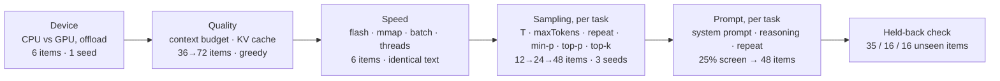

# Improving ModelDuck's tuner

A review of the settings tuner (**Bench & Tune → Tune**, `npm run tune`, `npm run tune:gate`) with measured
evidence and a prioritized plan.

| | |
|---|---|
| Snapshot | commit `6ece836`, suite v14 (262 items), node-llama-cpp 3.22.2. Line links point at that commit. |
| Date | 2026-11-01 |
| Method | Read every module on the tune path and ADR-021 to ADR-075. Re-ran each suspected defect through the repository's own `tune()`. Ran Monte Carlo studies through the real decision code. Checked the timing and determinism assumptions on the real engine with SmolLM2 135M and Qwen2.5 0.5B (CPU, 4-core Linux container, 3 threads). |
| Reproduce | Every number below comes from a script in [`docs/tuning-repro/`](tuning-repro/). See [Appendix A](#appendix-a-reproduction). |

The real-engine numbers come from a different machine than the one in the ADRs (i5-14400F, Radeon RX 9060 XT), so
read them as evidence that a mechanism exists, not as that PC's exact values. The simulations show how the decision
rules behave, given the stated assumptions about the items.

---

## Contents

1. [Summary](#1-summary)
2. [How a tune works today](#2-how-a-tune-works-today)
3. [Defects](#3-defects): D1 to D5
4. [What is measured vs. what is used](#4-what-is-measured-vs-what-is-used): M1 to M9
5. [Statistics: power, error control, item use](#5-statistics-power-error-control-item-use): S1 to S7
6. [Search strategy and search space](#6-search-strategy-and-search-space): G1 to G9
7. [Validation and governance](#7-validation-and-governance): V1 to V4
8. [Roadmap](#8-roadmap)
9. [How to tell the tuner got better](#9-how-to-tell-the-tuner-got-better)
- [Appendix A: Reproduction](#appendix-a-reproduction)
- [Appendix B: node-llama-cpp 3.22.2 options checked](#appendix-b-node-llama-cpp-3222-options-checked)

**Severity:** *High* means it changes what a tune chooses or ships in ordinary use; *Medium* means it weakens a
decision or a safeguard; *Low* means accuracy or UX. **Effort:** *S* ≤ 1 day, *M* 2–5 days, *L* 1–2 weeks.
**G-003** marks a change to items, rungs or the sweep, which needs a `SUITE_VERSION` bump, a CHANGELOG row and a
deliberate baseline update.

---

## 1. Summary

The tuner is already careful. It uses paired tests, Holm correction, sequential stopping with alpha spending, a
held-back check, per-type and per-view guards, resumable progress and a full answer log. The next gains come from
four places.

1. **Five defects change what a tune does, silently.** The worst one: a **Quick pass never gets the full search it
   promises**. The "full continuation" re-runs no axis at all. It marks the 12-item choices as final (82 answers
   instead of 516 in a reproduction). Another defect: the **required regression gate (G-001) cannot run**, because
   its baseline file was never created.
2. **The settings users feel most are measured least.**
   - The speed stage gets **0.6%** of a tune's answers.
   - On a real engine, it called *identical* settings "significantly different" in **20%** of comparisons.
   - It rejects most thread and batch candidates because rounding changed an answer's text (**9 of 18** answers
     changed by thread count alone), not because quality dropped.
   - The token budget is tuned as a cost to minimize, and then served as the hard cap on real requests.
3. **Statistical power is low where the answers go.**
   - **96%** of a tune's answers go to sampling and prompt choices.
   - Even so, a value that is truly **10 points better is chosen only 61%** of the time (5 points better: 17%).
   - **53 of the 136 code items (39%) are never used.**
   - Comprehension's "unseen" check reuses the same 8 functions.
   - Clustered items inflate false positives **3–4×**.
4. **The search space misses cheap, relevant knobs, and the starting point works against code.** The repeat
   penalty of 1.1 also penalizes newlines. It is on for every load-stage measurement and for the "defaults"
   baseline. Turning it off fixed 3 code items and broke none on Qwen2.5 0.5B. DRY, `penalizeNewLine`, mixed K/V
   cache types, response prefixes and stop triggers are available in the runtime but are not searched.

### Findings at a glance

| ID | Finding | Evidence | Severity | Effort |
|---|---|---|---|---|
| D1 | Quick pass → "full continuation" re-runs no axis and marks 12-item choices final | 0 search candidates, 82 vs 516 answers | High | S |
| D2 | Light/Quiet thread counts are set by a formula and may never have been measured | 6 and 3 threads from steps {1,2,4,8} | Medium | S |
| D3 | Preflight time ignores the selected stages | Device-only shows the 14.3 h full-tune time | Low | S |
| D4 | Rates are rounded before the tolerance test, so "one item" applies on 12 items but not on 24/46/48 | 91.7 ≥ 91.667, but 97.9 < 97.917 | Medium | S |
| D5 | `tune:gate` (G-001) has no baseline, and its rule is unpaired and blind to hardware | exits `tune_baseline_missing` | High | M |
| M1 | `maxTokens` is minimized as a cost, truncation isn't recorded, and the preset becomes the serving cap | `stopReason` discarded; `openai.js` default cap | High | M |
| M2 | Speed decisions rest on single, sequential timings | A/A: 20% false "significant"; per-item CV 4.6–9.4% | High | M |
| M3 | The "identical answer text" rule rejects speed candidates over rounding | threads 1–2: 9/18 changed; batch 64: 11/18 | High | M |
| M4 | The speed workload is 6 short, mostly prefill-bound items | time to first token is 63–95% of the time for 4 of the 6 items | Medium | M–L |
| M5 | Load stages and the defaults baseline run with repeat penalty 1.1 (newlines penalized) | 27.1% → 33.3% on 48 code items, 3–0 | Medium | S |
| M6 | KV cache is chosen on prompts of ≤ 1.2k tokens but served at up to 16k | longest prompt ≈ 1,176 tokens | Medium | M |
| M7 | Context budget = 60% of *transient* free memory, with an uncalibrated estimate | fixed 256 MiB reserve; budget inputs not stored | Medium | M |
| M8 | Timed stages can overlap other work | lock proceeds after 120 s; `/v1` is not paused | Medium | S–M |
| M9 | Decode tok/s counts n tokens over n−1 intervals, and VRAM is not recorded | +2 to +9% on the speed items | Low | S |
| S1 | Low power for realistic effects; halving drops the best | +10 pts chosen 61%; best cut at rung 1 in 5–22% | High | M |
| S2 | Majority vote throws away seed information | +10 pts detected 74% vs 89% with fractions | Medium | S–M |
| S3 | 39% of code items are unused; the saturation filter shrinks rungs instead of refilling them | 53/136 never asked | Medium | S (G-003) |
| S4 | Clustered items make paired p-values too optimistic | p ≤ 0.05 in 13.6–21.6% under no difference | Medium | M (G-003) |
| S5 | Held-back check: comprehension leaks; the fall-back rule is a coin flip for equal presets | 16/16 share a function; 46–48% fall back | Medium | S–M |
| S6 | An item counts as "saturated" after 2 observations, from any suite or device | `minObservations = 2` | Low | S |
| S7 | The device stage's accuracy rule decides on 6 items with no test | GPU loses on one item | Low–Medium | S |

### If you do five things first

1. **Fix D1, D2 and D4** (about two days). Quick-pass presets get the search they promise, Light and Quiet become
   measured values, and the tolerance means the same thing on every rung.
2. **Stop treating the token budget as a cost (M1).** Record `stopReason`, set the budget as a safety cap, and
   report the truncation rate.
3. **Rebuild the speed stage around throughput (M2–M4).** Use repeated, interleaved timings, prefill and decode
   tokens/s instead of identical text, and a task-weighted workload. Triple its answers; the cost is still about 1%
   of a tune.
4. **Make `tune:gate` real (D5, V1).** Use per-item paired outcomes, a machine-local baseline and an A/A noise floor.
   G-001 can't be honoured until this exists.
5. **Buy power with items you already have (S1–S3).** Add a confirmation rung from the 53 unused code items, test on
   seed fractions, and cut the 22-prompt lists down. That money comes from the system-prompt axis, which alone takes
   43% of a tune.

---

## 2. How a tune works today



| Stage | Chooses | Items | Seeds | Decision rule | Answers per model (share) |
|---|---|---|---:|---|---:|
| Device | backend, GPU layers | 6 speed items | 1 | GPU must be measurably faster (paired tok/s) and answer at least as many items as the CPU | 12 (0.1%) |
| Quality | context (memory budget), KV cache | 36 → 72, mixed tasks | 1 | best rate within one item, then cheapest latency, then memory; Holm-corrected gain for a quality-only change; per-task revert | 180 (1.0%) |
| Speed | flash, mmap, batch, threads | 6 speed items | 1 | fastest candidate whose answer text is unchanged; incumbent wins ties; Light/Quiet from the thread sweep | 102 (0.6%) |
| Sampling | temperature, maxTokens, repeat penalty, min-p, top-p, top-k | 12 → 24 → 48 per task | 3 at T > 0 | successive halving, sequential stop, tolerance, Holm | 7,596 (43.3%) |
| Prompt | system prompt (9 or 22), reasoning, prompt repeat | 25% screen, then 48 | 3 at T > 0 | same | 9,240 (52.7%) |
| Held-back | preset vs. defaults | 35 / 16 / 16 | 3 | fall back if the preset's rate is lower | 402 (2.3%) |

A full tune of one model asks up to **17,532 answers in one pass**. That is about 14.6 h at 3 s/answer, or 1.5 h at
0.3 s/answer on a GPU. The **system-prompt axis alone accounts for 7,500 answers (42.8%)**. These are upper bounds:
screening and sequential stopping cut them in practice.

**What already works well, and should be kept:**
- paired designs throughout;
- exact McNemar and Holm;
- alpha spending across looks (ADR-063);
- nested rungs with a per-item answer cache;
- the held-back check (ADR-054);
- per-task and per-view guards (ADR-057, ADR-070);
- per-type warnings with their own p (ADR-059);
- resumable, fully recorded runs (ADR-050, ADR-051);
- fingerprints with stale warnings;
- sandboxed checks.

The recommendations below build on these rather than replace them.

---

## 3. Defects

### D1. A Quick pass never receives its full continuation — *High, S*

**What happens.**
1. `--quick` runs every axis on its first rung (12 items).
2. Each finished sweep is recorded as `pass:axis` in the stage's `done` list
   ([`tune.mjs:354`](../benchmarks/tune.mjs#L354)).
3. The scheduler then starts the "full continuation" with `--continue`
   ([`tune-scheduler.js:295`](../src/tune-scheduler.js#L295)).
4. On resume, `isDone()` ([`tune.mjs:352`](../benchmarks/tune.mjs#L352)) skips every axis in `done`. Pass 1 changes
   nothing, so `descend()` stops before pass 2 ([`tune.mjs:286`](../benchmarks/tune.mjs#L286)).
5. `finished()` is now true ([`tune.mjs:350`](../benchmarks/tune.mjs#L350)), so every stage is marked **done**.

The result: the 12-item choices become the final preset, and only the final statistics and the held-back check are
measured.

**Evidence** ([`quick-continue.mjs`](tuning-repro/quick-continue.mjs)):

```
Quick pass    stages: {"device":"done","quality":"partial","speed":"partial","sampling":{"math":"partial",…},"prompt":{…"partial"}}
Continuation  search candidates measured: 0
Continuation  stages: {"device":"done","quality":"done","speed":"done","sampling":{"math":"done",…},"prompt":{…"done"}}
Continuation  answers asked: 82 vs a full tune: 516
```

**Why it matters.** ADR-074 states that "the full continuation still measures the same stages on the full rungs".
Instead, every Quick pass ships a preset chosen on 12 items. The one-item tolerance on 12 items is 8.3 points
(see D4). The UI then clears the *provisional* flag.

**Fix.**
- Record quick sweeps apart from `done`, for example `quick:${pass}:${axis}` or a `provisional` flag on the stage.
  The continuation then re-runs each axis on the full rungs, with the quick winner as the incumbent. Sequential
  stopping drops clearly worse challengers early, so confirming a good quick winner costs less than a fresh search.
- Add a test: "a quick pass followed by `--continue` measures every axis on the full rungs". Assert candidate events
  at the last rung size, and that an effect visible only on the full rung is found.

### D2. Light and Quiet can be thread counts nobody measured — *Medium, S*

**What happens.** Two paths end in the fallback `min(Fastest threads, cap)` in `threadsFor()`
([`tune-speed.mjs:82–87`](../benchmarks/tune-speed.mjs#L82-L87)). That is a value chosen by formula, not by
measurement:

1. **Resume.** [`tune.mjs:408–414`](../benchmarks/tune.mjs#L408-L414) treats "threads is a selected axis" as
   "threads was re-measured". When a continued or resumed run skips the finished thread sweep, `speedStage` has no
   thread entries.
2. **Changed text.** `chooseFastest()` drops every candidate whose answer text changed
   ([`tune-speed.mjs:15`](../benchmarks/tune-speed.mjs#L15)). On a real CPU, lower thread counts change answers
   often (see M3). When all of them do, nothing qualifies.

**Evidence.**
- [`quick-continue.mjs`](tuning-repro/quick-continue.mjs): Light/Quiet are 4/2 after the Quick pass and **6/3**
  after the continuation, though the measured steps were 1, 2, 4 and 8.
- [`presets-and-tolerance.mjs`](tuning-repro/presets-and-tolerance.mjs): one changed answer below 8 threads gives
  Light 6 and Quiet 3. On a 12-thread CPU, Quiet's 3 threads is not even a default step.

**Fix.**
- Persist the per-thread measurements in the speed progress, for example
  `threads: [{ threads, latencyMs, changed }]`, and derive Light and Quiet only from measured entries.
- Treat thread count as quality-neutral in expectation. Pick by speed among measured values at or under the cap,
  and guard on pass/fail rather than on text (M3).
- If nothing qualifies, store `null` and have Settings say the preset is unavailable.

### D3. The preflight shows the full-tune time for any selection — *Low, S*

**What happens.** `GET /api/tune/estimate` returns the answer count for the selected stages and settings, but the
seconds come from `estimateTune()`, which takes no stages or settings
([`server.js:519`](../src/server.js#L519), [`tune-grid.mjs:332`](../benchmarks/tune-grid.mjs#L332)). The Tune panel
shows both ([`app.js:2619`](../public/app.js#L2619)).

**Evidence** ([`budget-and-preflight.mjs`](tuning-repro/budget-and-preflight.mjs)):

| Selection | Answers | Seconds shown |
|---|---:|---:|
| all stages | 17,532 | 51,515 |
| prompt only | 9,642 | 51,515 |
| device only | 12 | 51,515 |

**Fix.** Pass `stages` and `only` into `estimateTune()`, or compute seconds as expected answers × measured pace,
plus reloads. Test that a device-only estimate is under a minute.

### D4. The one-item tolerance depends on rounding — *Medium, S*

**What happens.** `score()` rounds rates to one decimal ([`tune-measure.mjs:104`](../benchmarks/tune-measure.mjs#L104)).
`sweep()` compares them with an unrounded floor ([`tune.mjs:211–213`](../benchmarks/tune.mjs#L211-L213)). So
whether a candidate one item behind is "within tolerance" depends on which way the rounding goes:

```
n=12: one item lost -> rounded rate 91.7 vs floor 91.6667 -> inside the tolerance
n=24: one item lost -> rounded rate 95.8 vs floor 95.8333 -> outside the tolerance
n=46: one item lost -> rounded rate 97.8 vs floor 97.8261 -> outside the tolerance
n=48: one item lost -> rounded rate 97.9 vs floor 97.9167 -> outside the tolerance
48 items, T=0.7, last item lost on 2/3 seed(s): chose maxTokens 256 (incumbent 512), paired p=1
```

At T > 0, an item lost by majority (2 of 3 seeds) counts as 0.67 items, so it is accepted. In every accepted case
the paired p is 1. The tolerance stands in for evidence.

**Why it matters.** On full rungs the tuner is stricter than designed: no one-item trade for speed or tokens. On a
Quick pass it trades 8.3 points for fewer tokens. Each stage resets `stageBest`
([`tune.mjs:259`](../benchmarks/tune.mjs#L259)), so sampling and prompt can each make such a trade.

**Fix.**
- Compare counts, not rounded percentages: solved ≥ best solved − `toleranceItems`.
- State non-inferiority as a margin in points with a one-sided paired test, for example "the loss is under 2
  points at α = 0.2". A fixed item count changes meaning with rung size.

### D5. The required gate cannot run, and would be unreliable if it did — *High, M*

**What happens.**
- G-001 makes `npm run tune:gate` mandatory for every change that affects generation. The gate reads
  `benchmarks/baseline-profiles.json` ([`tune-gate.mjs:18`](../benchmarks/tune-gate.mjs#L18)), which has never been
  committed (the [benchmarks README](../benchmarks/README.md) says so). Every run exits with `tune_baseline_missing`.
- Even with a baseline, the rule is a fixed one-item drop in the rate
  ([`tune-baseline.mjs:33–51`](../benchmarks/tune-baseline.mjs#L33-L51)). It is unpaired, the baseline stores no
  per-item outcomes, and the identity check covers suite, task hash and runtime only
  ([`tune-baseline.mjs:7`](../benchmarks/tune-baseline.mjs#L7)), not the CPU or GPU. M3 shows that thread count alone
  changes 9 of 18 greedy answers, so a baseline from one PC passes or fails on another by rounding.

**Fix.** See [V1](#v1-a-gate-that-can-detect-regressions). Until it lands, note in each generation-affecting change
that the gate could not run, rather than implying it passed.

---

## 4. What is measured vs. what is used

### M1. The token budget is tuned as a cost and served as a cap — *High, M*

**What happens.**
- `maxTokens` is a sampling axis whose cost is answer tokens ([`tune.mjs:430`](../benchmarks/tune.mjs#L430)). Ties
  and the tolerance favor the shortest budget. The tests assert "the shortest budget that keeps every item"
  ([`tests/benchmark-tune.test.js:116`](../tests/benchmark-tune.test.js#L116)).
- The evaluator drops the engine's `stopReason` ([`tune-evaluate.mjs:104–114`](../benchmarks/tune-evaluate.mjs#L104-L114)),
  so a truncated answer looks like any other wrong answer.
- When serving, the task preset's `maxTokens` becomes the default cap for any request that does not send
  `max_tokens` ([`openai.js:86`](../src/openai.js#L86), [`331`](../src/openai.js#L331)). `code` is the default task
  ([`openai.js:323`](../src/openai.js#L323)).
- The sampling stage starts from `maxTokens: 512` ([`config.js:27`](../src/config.js#L20-L50)). That overrides the
  per-item budgets, so the **54 code items designed for 1,024 tokens** are cut at 512 in the incumbent and in the
  "defaults" baseline. The load stages use per-item budgets ([`tune.mjs:45`](../benchmarks/tune.mjs#L45)), so the
  two baselines do not match.

**Why it matters.** Suite answers are short; Qwen2.5 0.5B's median code answer was 56–63 tokens in our run.
Real coding requests (a file-wide refactor, a multi-function change) are longer. A cap fitted to the suite cuts them
off with `finish_reason: "length"`. That is the most visible failure a coding assistant can have.

**Fix.**
1. Record `stopReason`, `promptTokens` and `firstTokenMs` with every answer. The engine already computes them.
2. Take `maxTokens` out of cost minimization. Set it as a **safety cap**:
   `max(the task's largest per-item budget, 1.5 × p99 of passing answer lengths)`, rounded up to a step.
   Let verbosity be tuned by prompts and stop triggers, not by caps.
3. Report each preset's **truncation rate**, and refuse a preset that truncates passing-length answers.
4. In `openai.js`, apply a tuned cap only above a floor (for example ≥ 2,048 tokens for code), or not at all.

### M2. Speed decisions rest on single, sequential timings — *High, M*

**What happens.** Each speed candidate is answered **once** on 6 items with 1 seed, one after another, right after
its reload ([`tune-speed.mjs:37–52`](../benchmarks/tune-speed.mjs#L37-L52)). `costDelta()` calls a difference real
when it exceeds both a 3% band and 2 standard errors across the 6 items
([`tune-measure.mjs:143–156`](../benchmarks/tune-measure.mjs#L143-L156)).

**Evidence (A/A on the real engine).** Six measurements of the *same* settings, each with a reload and warm-up as a
candidate gets ([`real-engine.mjs`](tuning-repro/real-engine.mjs)):

```
E1 A/A: median latency per repeat (ms): 1014, 1102, 1110.5, 1098, 1127, 1075
E1 A/A: costDelta called identical settings "significantly different" in 6/30 ordered pairs
E1 per-item latency spread: CV 4.6% – 9.4%
```

The first run was 8% faster than the others. A whole run shifts together, and a standard error across the 6 items
cannot see that.

**Why it matters.** Fastest, Light, Quiet, the device verdict and the latency tie-breaks can all flip on noise. With
7 thread values and 6 batch sizes per pass, a false "significantly faster" challenger is likely somewhere.

**Fix.**
- Measure each candidate **at least 3 times, interleaved** (A B C A B C …), after a warm-up that includes one long
  prompt.
- Decide on run-level medians with a bootstrap interval, or Welch on run totals.
- Set the tie band from a built-in A/A, with the incumbent measured twice: band = max(5%, 2 × A/A spread).
- Today the stage asks 102 answers. Tripling that costs about 200 more, roughly 1% of a tune.

### M3. "Identical answer text" rejects speed candidates over rounding — *High, M*

**What happens.** The speed stage excludes any candidate whose answer text (digest) differs from the stage's start
([`tune-speed.mjs:15`](../benchmarks/tune-speed.mjs#L15), [`52`](../benchmarks/tune-speed.mjs#L52)). The device stage
needs the GPU to answer at least as many of the 6 items as the CPU
([`tune-device.mjs:66`](../benchmarks/tune-device.mjs#L66)).

**Evidence (real engine, CPU, greedy, 18 items: 6 speed and 12 code).**

| Change from threads 3, batch 512 | Answers changed | Notes |
|---|---:|---|
| threads 1 | 9 / 18 | includes speed item `bug-sum-to` |
| threads 2 | 9 / 18 | |
| batch 64 | 11 / 18 | includes speed items `read-sumTo-1`, `read-clamp-1` |
| batch 128 | 4 / 18 | none of the 6 speed items changed, so it would pass the rule |
| flash attention on | 0 / 18 | |
| mmap off | 0 / 18 | |

**Why it matters.** Whether a faster thread count or batch size can win depends on bit-level rounding on a 6-item
workload, and not on quality. It also triggers D2. GPUs, with their own kernels, diverge more (ADR-031).

**Fix.** Base speed on throughput that does not depend on the answer, and guard quality separately:
- **Prefill tokens/s** = `promptTokens / firstTokenMs`. The prompts are identical across candidates.
- **Decode tokens/s** = `(n − 1) / (t_last − t_first)`. It stays comparable when answers differ.
- **Quality guard on pass/fail, not text.** A changed digest is fine if no item flips. If one does, run a
  non-inferiority check on the 36-item load rung (greedy, 1 seed; about 36 answers).

### M4. The speed workload is not the code workload — *Medium, M–L*

**What happens.** The workload ([`tasks.mjs:151–159`](../benchmarks/tasks.mjs#L151-L159)) is the first one or two
items of each task:

```
javascript           prompt   47 · out  75 · time to first token 41% of 676 ms
read-sumTo-1         prompt   94 · out  32 · time to first token 65% of 599 ms  · stop maxTokens
needle               prompt 1412 · out  12 · time to first token 95% of 2570 ms
bug-sum-to           prompt  103 · out 173 · time to first token 24% of 1375 ms
read-clamp-1         prompt   89 · out  32 · time to first token 63% of 536 ms  · stop maxTokens
recall-locker-first  prompt  605 · out  16 · time to first token 89% of 1132 ms · stop maxTokens
```

Four of the six items are dominated by prefill, and only one has a long answer.

**Why it matters.** Code answers are decode-heavy (hundreds of tokens), and codebase prompts are prefills of about
1k tokens. Batch size mostly affects prefill. Threads affect prefill and decode differently: decode is bound by
memory bandwidth and often peaks at fewer threads, especially on hybrid P/E-core CPUs. "Fastest" is currently fastest
for short prompts with short answers.

**Fix.**
- Measure prefill and decode throughput separately (M3).
- Predict each task's latency from its own token profile: median prompt and answer tokens of the preset's answers,
  which are already in `answers.jsonl`.
- Choose the load settings that minimize *task-weighted* latency. Weight by how the user uses tasks, with `code`
  as the default.

This is the deferred "speed on long prompts" item of the `tune-smarter` plan in the AIKit ledger.

### M5. Load stages and the defaults baseline run with the repeat penalty on — *Medium, S*

**What happens.**
- Every tune starts from `DEFAULT_SETTINGS`: temperature 0.7, top-p 0.9, repeat penalty 1.1 over 64 tokens
  ([`config.js:20–50`](../src/config.js#L20-L50), [`tune-job.mjs:53`](../benchmarks/tune-job.mjs#L53)).
- The device, quality and speed stages force temperature 0 but keep the 1.1 penalty
  ([`tune.mjs:45`](../benchmarks/tune.mjs#L45), [`tune-evaluate.mjs:22–31`](../benchmarks/tune-evaluate.mjs#L22-L31)).
- The engine never sets `penalizeNewLine` ([`engine.js:565–571`](../src/engine.js#L565-L571)). node-llama-cpp defaults
  it to **true**, so newlines, which code is full of, are penalized too.

**Evidence** ([`repeat-penalty.mjs`](tuning-repro/repeat-penalty.mjs), Qwen2.5 0.5B, greedy, the code task's 48
tuning items):

```
repeatPenalty 1.1: 27.1% of 48 code items · median 56 tokens
repeatPenalty 1:   33.3% of 48 code items · median 62.5 tokens
paired: 3 items fixed by turning the penalty off, 0 broken; exact McNemar p=0.25
```

The direction is clear, but the sample is too small to pass the tuner's own bar. A 3–0 split *cannot* reach
p ≤ 0.2; the minimum is 4–0. Incumbents win ties, so a poor starting value tends to stick (S1).

**Fix.**
- Run the load stages with the repeat penalty off; they are greedy anyway.
- Start code's sampling stage from repeat 1.0.
- Add `penalizeNewLine: false` and DRY as candidates (G4).
- Use the tuner itself to reconsider `DEFAULT_SETTINGS` for a coding server, on the gate models.

### M6. The KV cache is chosen on short prompts and served at long contexts — *Medium, M (G-003)*

**What happens.** The longest suite prompt is about 1,176 tokens (4,704 characters). The context budget goes up to
16,384 ([`tune-grid.mjs:90`](../benchmarks/tune-grid.mjs#L84-L114)). The KV choice (f16, q8_0 or q4_0) is made on
the short prompts and then applies at the budgeted context. The error of a quantized KV cache grows with context
length.

**Fix.**
- Add a few long items (4k, 8k and 16k tokens of code to read, or recall), generated from a fixed seed like the
  recall items.
- Use them only to confirm the KV choice at the budgeted context: non-inferiority against f16, greedy, 1 seed.
  Skip sizes above the budget.
- Also try mixed K/V types (G4).

### M7. The context budget depends on transient memory and an uncalibrated estimate — *Medium, M*

**What happens.**
- `budgetContext()` takes the largest step whose estimate fits in **60% of free memory at tune time**
  ([`memory-fit.js:15`](../src/memory-fit.js#L15), [`60–79`](../src/memory-fit.js#L60-L79)). Free memory includes
  whatever else is running, even the ModelDuck server's own loaded model.
- The estimate is weights + KV + a fixed 256 MiB reserve ([`memory-fit.js:14`](../src/memory-fit.js#L14)). Compute
  buffers grow with batch size and context, and ADR-021 notes the estimate is uncalibrated.
- `availableMemory()` counts the loaded model's *file size* as reclaimable but not its context. On a GPU it adds the
  whole file size to free VRAM, even for a partial offload ([`engine.js:153`](../src/engine.js#L153)).
- None of these inputs is stored, so a profile does not say what budget it assumed.

**Fix.**
- Budget against **total** memory minus a reserve the user sets (a "memory budget" setting), not momentary free
  memory.
- Use node-llama-cpp's `estimateContextResourceRequirementsV2()`, which accounts for batch size, flash, K/V types,
  mmap and offloaded layers. Or calibrate `memory-fit.js` against `getLlamaMemoryUsage()`.
- Record the budget inputs in the profile.

### M8. Timed stages can overlap other work — *Medium, S–M*

**What happens.**
- The timing lock waits up to 120 s for other tunes to pause, then **proceeds anyway**
  ([`tune-lock.js:23`](../src/tune-lock.js#L23), [`102`](../src/tune-lock.js#L102)). A 2,048-token answer on a CPU
  lane can outlast that wait, and nothing records it.
- The server's own `/v1` traffic is not paused during timed stages. Busy is checked only when a tune starts
  ([`server.js:426`](../src/server.js#L426)).
- The quality stage breaks ties on latency ([`tune.mjs:381`](../benchmarks/tune.mjs#L381)) while other lanes run
  untimed.

**Fix.**
- Record `settled` with each timed measurement, and re-measure when it is false.
- Let the server join the lock: pause timed stages while a reply runs, or answer 503 with `Retry-After` during one.
- Break quality-stage ties on tokens and memory instead of latency.

### M9. Small measurement errors — *Low, S*

- **Decode rate.** [`engine.js:595–598`](../src/engine.js#L589-L598) divides n tokens by the time *after* the first
  token, which covers n − 1 intervals, using `Date.now()`. On the speed items this reads 2% to 9% high (needle: 94.5
  vs. 86.6 tok/s). In the device stage, answers differ in length between devices, so the bias differs between the
  two sides. Fix: use `(n − 1) / (t_last − t_first)` with `performance.now()`, and leave answers under about 16
  tokens out of decode rates.
- **VRAM.** The evaluator keeps only `cpuRam` from `getLlamaMemoryUsage()`
  ([`tune-evaluate.mjs:55`](../benchmarks/tune-evaluate.mjs#L55)), which also returns `gpuVram`. On a GPU the KV cache
  lives in VRAM, so the memory tie-break cannot see a quantized KV cache's saving. Fix: record both, and break ties
  on the chosen device's memory.

---

## 5. Statistics: power, error control, item use

### S1. Low power for realistic effects; halving drops the best — *High, M*

[`power.mjs`](tuning-repro/power.mjs) runs one sampling axis through the real `tune()`: 6 values, with value 3 truly
better by a set number of points. The items are 40% discriminating (pass rate 0.2–0.8), 30% near-always-fail and
30% near-always-pass, answered at T = 0.7 with the default 3 seeds. 400 simulations per row:

| Rungs | True gain | Best value chosen | Wrong change | Best reached rung 2 | Answers per sweep |
|---|---:|---:|---:|---:|---:|
| 12/24/48 (today) | 0 | – | 5.0% | – | 516 |
| 12/24/48 (today) | +5 pts | **17.3%** | 3.5% | 77.5% | 525 |
| 12/24/48 (today) | +10 pts | **61.0%** | 0.3% | 95.0% | 532 |
| 12/24/48 (today) | +15 pts | 90.8% | 0.0% | 98.5% | 531 |
| 12/24/48/96 | +5 pts | 39.3% | 3.3% | 77.5% | 884 |
| 12/24/48/96 | +10 pts | **87.3%** | 1.0% | 95.0% | 898 |
| 12/24/48/96 | +15 pts | 98.3% | 0.0% | 98.5% | 880 |

When the better value also costs more tokens, it is chosen slightly less often (58.8% at +10 points), because the
rung-1 cut ranks ties by cost. The error control is fine: about 5% wrong changes when nothing differs. The power is
the problem.

**Fix, in order of value per answer:**
1. **A confirmation rung from the unused code items (S3).** Score only the incumbent and the leading challenger on
   them. That is about 2 × 53 × 3 answers per sweep, close to the simulated +65%, paid for by G1.
2. **Halving that tolerates noise.** Keep the top half *plus* any candidate within one standard error of the leader.
   Cutting on rank at 12 items is how the true best is lost in 5–22% of sweeps.
3. **Seed fractions instead of majority votes (S2).**
4. **Refill saturated items from the whole tuning pool (S3)**, so every rung is discriminating.

### S2. Majority vote throws away seed information — *Medium, S–M*

`paired()` runs McNemar on each item's **majority of 3 seeds**
([`tune-measure.mjs:116`](../benchmarks/tune-measure.mjs#L116), [`127`](../benchmarks/tune-measure.mjs#L127)), while
`rate` averages the fractions. The two can disagree: a candidate can lead on rate while c ≤ b. With 48 items and one
challenger ([`stats-micro.mjs`](tuning-repro/stats-micro.mjs), 4,000 runs; both tests at one-sided 0.1):

| Discriminating items | True gain | McNemar on majority (today) | Sign-flip on fractions |
|---|---:|---:|---:|
| 40% | 0 | 4.8% | 8.4% |
| 40% | +5 pts | 30.2% | **47.3%** |
| 40% | +10 pts | 73.9% | **89.3%** |
| 100% (after the saturation filter) | 0 | 6.2% | 9.1% |
| 100% | +5 pts | 22.3% | **34.9%** |
| 100% | +10 pts | 50.2% | **68.8%** |

**Fix.**
- Use a paired **sign-flip (permutation) test** on per-item fraction differences. Enumerate exactly when there are
  at most 20 non-zero differences, and use a seeded Monte Carlo above that, so results stay reproducible.
- Use the same statistic in `perTaskCheck`, `groupEvidence` and `byType`.
- At temperature 0 it reduces to McNemar.

### S3. 39% of code items are never used — *Medium, S (G-003)*

`taskRungs()` stops at 48 ([`tasks.mjs:103–111`](../benchmarks/tasks.mjs#L103-L111)). The code task has 101 items
it could tune on (136 minus 35 held back), so **53 items (39%) are never asked**: 16 code, 13 bugfix, 12 code-repo,
3 code-long, 3 bugfix-long, 3 bugfix-repo and 3 public-code ([`suite-usage.mjs`](tuning-repro/suite-usage.mjs)).
Of the 36 codebase items, 15 are unused.

The saturation filter makes this worse. `withDiscriminatingRungs()` filters the *same* 48 items
([`tasks.mjs:134`](../benchmarks/tasks.mjs#L134)), so a model with many saturated items searches on fewer items,
instead of on other discriminating ones from the 53.

**Fix.**
- Refill the rungs from the full tuning pool after filtering.
- Use the remainder as the confirmation rung (S1), or grow the code holdout (S5).

### S4. Clustered items make p-values too optimistic — *Medium, M (G-003)*

Comprehension is **8 functions × 8 inputs** ([`comprehension-items.mjs:63`](../benchmarks/comprehension-items.mjs#L63)),
and the 36 codebase items share **7 codebases**. McNemar treats every item as independent. A setting that changes
how a model reads one function flips several of its inputs together.

Simulated with **no real difference** between the settings ([`stats-micro.mjs`](tuning-repro/stats-micro.mjs)):

| Functions whose reading a setting perturbs | Item McNemar p ≤ 0.05 (nominal 5%) | p ≤ 0.20 (nominal 20%) | Function-level sign test p ≤ 0.05 |
|---|---:|---:|---:|
| 15% | **13.6%** | 29.7% | 1.6% |
| 30% | **21.6%** | 39.3% | 1.2% |

This affects comprehension's sampling and prompt decisions, the per-task revert (ADR-057), the view guard (ADR-070)
and the per-type warnings (ADR-059).

**Fix.**
1. **Suite:** more functions with fewer inputs each. For example, 32 functions × 2 inputs keeps 64 items but gives
   4× more independent clusters. Give codebase items a `group` (their codebase id).
2. **Statistics:** a cluster sign-flip test that flips the signs of per-cluster summed differences. It stays valid
   under clustering. With only 8 clusters it is conservative, which is why the suite change matters.

### S5. The held-back check leaks, and its rule is a coin flip for equal presets — *Medium, S–M*

**What happens.**
- **Leak.** All 16 of comprehension's held-back items are other inputs of the same functions it tuned on. In the
  code task, 9 of 35 held-back items share a codebase with tuned items ([`suite-usage.mjs`](tuning-repro/suite-usage.mjs)).
  `bucketKey()` stratifies by `group` ([`tasks.mjs:56–58`](../benchmarks/tasks.mjs#L56-L58)), but codebase items
  have none.
- **Rule.** A preset falls back to the defaults whenever its held-back rate is lower
  ([`tune.mjs:499`](../benchmarks/tune.mjs#L499), [`575`](../benchmarks/tune.mjs#L575)). There is no test, and cost
  is not considered. Simulated ([`stats-micro.mjs`](tuning-repro/stats-micro.mjs)):

| Held-back items | Preset's true gain | Falls back |
|---:|---:|---:|
| 16 | 0 (equal) | 45.9% |
| 16 | +5 pts | 18.6% |
| 16 | +10 pts | 5.9% |
| 35 | 0 (equal) | 48.4% |
| 35 | +5 pts | 11.2% |
| 35 | +10 pts | 1.1% |

  An equal but cheaper preset (fewer tokens, faster) is thrown away about half the time.
- **Reuse.** Every re-tune consults the same held-back items. With repeated adaptive use, they slowly stop being
  "unseen".

**Fix.**
- Hold back **whole functions and codebases** (group-level split).
- Fall back only when the preset is *significantly* worse, using a one-sided, cluster-aware test, or worse beyond a
  margin. Keep an equal preset that is cheaper.
- Report the held-back estimate with its interval.
- Rotate two held-back folds between re-tunes, or show "held-back set used N times".

### S6. "Saturated" rests on two observations from any context — *Low, S*

`itemOutcomes()` marks an item saturated after **2** observations with the same outcome
([`tune-runs.js:225`](../src/tune-runs.js#L225)). It reads every run of the model, whatever its suite version, task
hash, runtime or device. The two observations are often greedy answers from the load stages. So an item that is
hard but fixable (a format or budget problem) can leave the search early.

**Fix.**
- Require at least 6 observations across at least 2 distinct sampling or prompt settings.
- Filter runs by fingerprint and device.
- Re-admit a random 10% of saturated items each tune, to catch drift.

### S7. The device stage's accuracy rule decides on 6 items — *Low–Medium, S*

A GPU must answer at least as many of the 6 speed items as the CPU
([`tune-device.mjs:66`](../benchmarks/tune-device.mjs#L66)). One rounding-induced loss rejects a GPU that is 5×
faster (ADR-031 measured 109 vs. 20 tok/s for Qwen2.5 Coder 1.5B).

**Fix.** When the speed gain is large, decide accuracy by non-inferiority on the 36-item load rung (greedy, 1 seed)
instead of a 6-item count.

---

## 6. Search strategy and search space

### G1. Spend answers where they buy something

| Spend today | Answers | Observation |
|---|---:|---|
| system-prompt axis (9 + 22 + 22 prompts) | 7,500 (42.8%) | ADR-036 found most prompts tie; the screen trims, but this is still the largest item |
| other sampling and prompt axes | 9,336 (53.3%) | top-k next to min-p rarely matters for 0.5–3B models; prompt repeat doubles prefill for little gain on generation tasks |
| speed + device | 114 (0.7%) | these decide every request's latency (M2–M4) |

**Suggestions.**
- **Shrink comprehension's and recall's 22 prompts to about 6.** Retire prompts that never won on any tuned model;
  the profiles already record the winners.
- **Tune top-k only when min-p is 0**, and make prompt repeat opt-in for code.
- **Screen with 1 seed** on rung 1 at T > 0, and decide with 3.
- **Reallocate** the savings to the confirmation rung (S1) and to repeated speed timings (M2).

### G2. Coordinate descent misses interactions

Temperature interacts with min-p, top-p and top-k. When temperature 0 wins first, those three are skipped as no-ops
([`tune.mjs:270–272`](../benchmarks/tune.mjs#L270-L272)). The second pass runs only if something changed
([`tune.mjs:286`](../benchmarks/tune.mjs#L286)). So once temperature 0 wins, a combination such as "T 0.2 with
min-p 0.1" is never tried. KV × flash and
threads × batch interact too.

**Fix.**
- Replace the temperature, min-p and top-p axes with one **sampler-profile axis** of 6–8 known-good combinations,
  for example:
  - greedy;
  - T 0.2 / min-p 0.1;
  - T 0.5 / min-p 0.05 / top-p 0.95;
  - T 0.8 / min-p 0.1.
- Add the deferred "pair check" from the `tune-smarter` plan: the best two values of the two settings that mattered
  most, tried together.

### G3. Start where code does well

Incumbents win ties, and power is limited (S1), so the starting point largely decides the outcome. The load stages
run greedy at per-item budgets with a repeat penalty. The sampling stage starts at T 0.7, top-p 0.9, repeat 1.1 and a
512-token cap (M1, M5).

**Fix.** Start code at T 0, repeat off, and a budget at or above the largest per-item budget. Keep comparing the
final preset against the *server defaults*, since that comparison says whether tuning helped.

### G4. Runtime knobs available but not searched

All of these are in node-llama-cpp 3.22.2's type definitions ([Appendix B](#appendix-b-node-llama-cpp-3222-options-checked)):

| Knob | Why it fits a coding tuner | Suggested steps |
|---|---|---|
| `repeatPenalty.penalizeNewLine` | default **true** penalizes code's newlines (M5) | false (code default), true |
| `dryRepeatPenalty` (DRY) | stops verbatim loops without penalizing legitimate repetition such as brackets and names | strength 0, 0.8; `allowedLength` 2–4 |
| `repeatPenalty.frequencyPenalty`, `presencePenalty` | gentler alternatives to a flat penalty | 0, 0.1 |
| separate `experimentalKvCacheKeyType` / `ValueType` | K is usually more sensitive than V; mixed pairs save memory at lower risk | f16/q8_0, q8_0/q4_0 |
| `responsePrefix` | makes a small model open with a code fence instead of prose | none, "```javascript\n" for code (check against the checkers) |
| `customStopTriggers` | stops after the first complete code block for "return only the code" | off, closing fence (verify multi-block answers) |
| `budgets.thoughtTokens` | needed if reasoning models (Qwen3, R1 distills) join the catalog | 512, 1024, unlimited |
| `swaFullCache` | prefix reuse versus memory on sliding-window models (Gemma family) | off, on, only for SWA models |

`threads` is a single value: llama.cpp's separate prompt-processing thread count is not exposed. The benchmarks
README already lists `n_ubatch` as unsupported.

### G5. The "deep" reasoning directive contradicts itself

"Think through the problem carefully before giving the final answer. **Show only the answer** the user asked for"
([`generation-manifest.js:24`](../src/generation-manifest.js#L24)) is combined with the suite prompt's "Do not
explain unless the user asks" ([`suite.mjs:15`](../benchmarks/suite.mjs#L15)). The model cannot think in text, so
"deep" is a nudge, not reasoning.

**Fix.** Offer a real chain-of-thought step, for example "think step by step in a few short sentences, then give the
final answer on its own line or in a final code block". The checkers already read the last code block and the
"Answer:" line (ADR-052). Give it room the way ADR-046 does.

### G6. Use partial credit as a finer signal (G-003)

Code items have 2–7 test cases (median 3–4), but an item counts only when *all* pass
([`stats.mjs:50–52`](../benchmarks/stats.mjs#L50-L52)). Using the fraction of cases passed as each item's score in
the paired test makes each item more informative. Keep "all pass" as the headline rate.

### G7. Explore GPU offload beyond "load failed"

Smaller offloads are tried only when the full offload *fails to load* ([`tune-device.mjs:54`](../benchmarks/tune-device.mjs#L54)).
A full offload that spills into shared memory loads fine, runs slowly, and then loses to the CPU without a partial
offload ever being tried.

**Fix.** Try 75% and 50% when the full offload is not clearly faster. Record VRAM headroom with `getVramState()`.

### G8. Reuse answers across runs

The measurement cache lives in memory ([`tune-measure.mjs:21–57`](../benchmarks/tune-measure.mjs#L21-L57)), so
continues and re-tunes re-ask incumbents. `answers.jsonl` already holds settings, seed, item and outcome.

**Fix.** Prefill the cache from earlier answers whose exact settings, seed, item and fingerprint (including device)
match.

### G9. Cover how coding assistants are used

Every item is a single turn in a fresh session, so the checkpoint axis can never matter (ADR-029), and follow-up
fixes are never measured.

**Fix.** A few two-turn items, such as "here is the failing test output, fix it", would measure both, and also
exercise prefix reuse.

---

## 7. Validation and governance

### V1. A gate that can detect regressions

1. **Machine-local baseline by default.** Store it under the data folder with a hardware identity (CPU, GPU and
   driver, threads). Allow a committed reference baseline only for a named reference machine.
2. **Per-item outcomes** for each model and task, with the seed fractions.
3. **A paired decision.** Run a sign-flip (or McNemar) test per model and task, Holm across them, with a floor, as
   `compareRuns()` already does for the cross-model bench ([`stats.mjs:101–142`](../benchmarks/stats.mjs#L101-L142)).
   Name the regressed items.
4. **A noise floor.** Re-measure the baseline once (A/A) when it is created, and store the flip rate. A run "fails"
   only beyond that.
5. Keep latency informational, but report it with the M2 method.

### V2. Statistical regression tests in `npm test`

The mechanics tests run with `changeAlpha: Infinity` ([`tests/benchmark-tune.test.js:83`](../tests/benchmark-tune.test.js#L83)),
so nothing protects the statistical behavior. Add seeded simulations (a smaller [`power.mjs`](tuning-repro/power.mjs),
about 3 s) that assert:
- wrong changes ≤ 7% under no difference;
- +10 points chosen at least as often as today (and above 85% once S1 lands);
- an equal but cheaper preset falls back ≤ 10% (once S5 lands).

### V3. Version what decides

Add `tunerVersion` (the decision-rule version), the engine and generation-manifest version, and the GPU name and
driver to `FINGERPRINT_KEYS` ([`model-profiles.js:24–26`](../src/model-profiles.js#L24-L26)). Then changes like
ADR-037 (no system prompt was ever sent) or ADR-063 (new decision rule) mark old profiles stale automatically,
instead of relying on a note.

### V4. Record, then show, the evidence

- Per answer: `stopReason`, `promptTokens`, `firstTokenMs`, decode rate, `gpuVram`, and whether the timing lock was
  settled.
- In Details: each decision's n, p and margin; the truncation rate; the prefill and decode throughput; and a
  "decided on 12 items, provisional" label until the full rung confirms it.

---

## 8. Roadmap

| Phase | Items | Suite change | Effort |
|---|---|---|---|
| **0. Correctness** | D1, D2, D3, D4; record `stopReason`, `promptTokens`, `firstTokenMs`, `gpuVram` and `settled` (M8, M9, V4) | none | 2–3 days |
| **1. Gate and serving safety** | D5 and V1 (paired, machine-local, A/A floor); M1 (budget as a safety cap, truncation rate); M5 (repeat penalty off in load stages, `penalizeNewLine` candidate) | none | ~1 week |
| **2. Speed stage rebuild** | M2 (repeats, interleaving, A/A band), M3 (throughput, pass/fail guard), M4 (task-weighted prefill and decode), S7, G7, M7 (runtime estimator, memory budget) | none | 1–2 weeks |
| **3. Statistical efficiency** | S1 (confirmation rung, tolerant halving), S2 (fractions), S3 (use and refill the pool), S5 (rule, group-level split), S6, V2, V3, G8 | rungs and holdout (G-003) | 1–2 weeks |
| **4. Suite and search space** | S4 (comprehension redesign, codebase groups), M6 (long-context items), G1 (prompt pruning), G2 (sampler profiles, pair check), G4 (DRY, `penalizeNewLine`, mixed K/V, prefix, stops), G5, G6, G9 | yes (G-003) | 2–4 weeks |

Do phases 0 and 1 first. Without them, the other phases can't be trusted or gated. Phases 3 and 4 change what a
profile was measured on, so do each in one suite bump with a regenerated baseline, as G-003 requires.

---

## 9. How to tell the tuner got better

| Measure | Today | Target | How |
|---|---|---|---|
| +10-point value chosen | 61% | ≥ 85% | `power.mjs` (V2) |
| Wrong changes when nothing differs | 5% | ≤ 5% | `power.mjs` |
| Speed A/A false "significant" | 20% | ≤ 5% | built-in A/A (M2) |
| Speed candidates rejected for text only | 9–11 of 18 answers changed | 0 rejections without a pass/fail flip | M3 log |
| Preset truncation rate (suite + long items) | not recorded | ≤ 1% | `stopReason` (M1) |
| Equal but cheaper preset discarded by the held-back check | 46–48% | ≤ 10% | `stats-micro.mjs` (S5) |
| Gate runs on every generation change | never (no baseline) | always, with a stated noise floor | V1 |
| Full tune of one model (one pass) | 17,532 answers | ≤ 12,000 with higher power | `budget-and-preflight.mjs` |

---

## Appendix A: Reproduction

All scripts live in [`docs/tuning-repro/`](tuning-repro/) and import the repository's own modules. Run them from the
repository root.

| Script | Sections | Needs | Runtime |
|---|---|---|---|
| [`quick-continue.mjs`](tuning-repro/quick-continue.mjs) | D1, D2 | nothing | < 1 s |
| [`presets-and-tolerance.mjs`](tuning-repro/presets-and-tolerance.mjs) | D2, D4 | nothing | < 1 s |
| [`budget-and-preflight.mjs`](tuning-repro/budget-and-preflight.mjs) | 2, D3, G1 | nothing | < 1 s |
| [`suite-usage.mjs`](tuning-repro/suite-usage.mjs) | S3, S5, M4, M6 | nothing | < 1 s |
| [`power.mjs`](tuning-repro/power.mjs) | S1 | nothing (`node docs/tuning-repro/power.mjs 400`) | ~16 s |
| [`stats-micro.mjs`](tuning-repro/stats-micro.mjs) | S2, S4, S5 | nothing | ~30 s |
| [`real-engine.mjs`](tuning-repro/real-engine.mjs) | M2, M3, M4, M9 | `npm install`; a folder with `SmolLM2-135M-Instruct-Q4_K_M.gguf` | ~10 min on 4 cores |
| [`repeat-penalty.mjs`](tuning-repro/repeat-penalty.mjs) | M5 | `npm install`; a folder with `qwen2.5-0.5b-instruct-q4_k_m.gguf` | ~4 min on 4 cores |

The two model files were downloaded from the catalog's repositories and matched the catalog's pinned SHA-256. The
simulations use fixed seeds, so they reproduce the tables exactly.

**Simulation assumptions.**
- 40% of items are discriminating (single-answer pass rate 0.2–0.8), 30% near-always-fail (0.02) and 30%
  near-always-pass (0.98).
- A "gain" is the average improvement over the whole item set, produced by a logit shift on discriminating items.
- In the cluster study, a setting re-rolls whether each function is understood with a given probability. Items pass
  with 0.9 when it is understood and 0.1 when it is not.
- Other mixes change the numbers, not the direction.

<details>
<summary>Raw output: real engine (SmolLM2 135M Q4_K_M, CPU, 3 threads)</summary>

```
model SmolLM2-135M-Instruct-Q4_K_M.gguf, 6 speed items: javascript, read-sumTo-1, needle, bug-sum-to, read-clamp-1, recall-locker-first

E1 A/A: median latency per repeat (ms): 1014, 1102, 1110.5, 1098, 1127, 1075
E1 A/A: costDelta called identical settings "significantly different" in 6/30 ordered pairs; digests identical across repeats: true
E1 per-item latency spread:
  javascript: mean 815 ms, CV 9.4%
  read-sumTo-1: mean 594 ms, CV 6.1%
  needle: mean 2804 ms, CV 4.6%
  bug-sum-to: mean 1506 ms, CV 8.8%
  read-clamp-1: mean 569 ms, CV 4.7%
  recall-locker-first: mean 1361 ms, CV 6.7%

E2 reference (threads 3, batch 512) on 18 items
E2 {"threads":1}              changed answers:  9/18 (bug-sum-to, code-long-calculator, bug-long-binary-search, repo-cart-total, …) · median 4344 ms vs 1700.5 · speed delta significant: true (4748.1 ms)
E2 {"threads":2}              changed answers:  9/18 (bug-sum-to, code-long-calculator, bug-long-binary-search, repo-cart-total, …) · median 2049 ms vs 1700.5 · speed delta significant: false (238.2 ms)
E2 {"batchSize":64}           changed answers: 11/18 (read-sumTo-1, bug-sum-to, read-clamp-1, code-long-calculator, …) · median 1653.5 ms vs 1700.5 · speed delta significant: false (36.3 ms)
E2 {"batchSize":128}          changed answers:  4/18 (code-long-calculator, bug-long-binary-search, bug-long-merge-intervals, repo-tokenize-digits) · median 1499 ms vs 1700.5 · speed delta significant: true (-352.1 ms)
E2 {"flashAttention":"on"}    changed answers:  0/18 · median 1705.5 ms vs 1700.5 · speed delta significant: false (-278.8 ms)
E2 {"useMmap":"off"}          changed answers:  0/18 · median 1672.5 ms vs 1700.5 · speed delta significant: false (-237.5 ms)

E3 per item: prompt tokens, output tokens, time to first token, total, engine tok/s vs (n-1)/decode-time
  javascript             prompt    47 · out   75 · TTFT   278 ms (41% of 676 ms) · engine 188.44 tok/s vs corrected 185.9 · stop eogToken
  read-sumTo-1           prompt    94 · out   32 · TTFT   387 ms (65% of 599 ms) · engine 150.94 tok/s vs corrected 146.2 · stop maxTokens
  needle                 prompt  1412 · out   12 · TTFT  2443 ms (95% of 2570 ms) · engine 94.49 tok/s vs corrected 86.6 · stop eogToken
  bug-sum-to             prompt   103 · out  173 · TTFT   334 ms (24% of 1375 ms) · engine 166.19 tok/s vs corrected 165.2 · stop eogToken
  read-clamp-1           prompt    89 · out   32 · TTFT   336 ms (63% of 536 ms) · engine 160 tok/s vs corrected 155.0 · stop maxTokens
  recall-locker-first    prompt   605 · out   16 · TTFT  1006 ms (89% of 1132 ms) · engine 126.98 tok/s vs corrected 119.0 · stop maxTokens
```

The speed deltas of rows whose answers changed compare answers of different lengths, so read only the
changed-answer counts there.

</details>

<details>
<summary>Raw output: repeat penalty (Qwen2.5 0.5B Q4_K_M, CPU, 3 threads, greedy)</summary>

```
repeatPenalty 1.1: 27.1% of 48 code items · median 56 tokens · 125 s
repeatPenalty 1: 33.3% of 48 code items · median 62.5 tokens · 120 s
paired: 3 items fixed by turning the penalty off, 0 broken; exact McNemar p=0.25
```

</details>

<details>
<summary>Raw output: suite usage and answer budget</summary>

```
code           items 136 · searched/final 48 · held back 35 · never used 53 (39%) · families 7 · held items sharing a family with tuned items 9/35
               never used by category: {"code":16,"bugfix":13,"code-repo":12,"code-long":3,"bugfix-long":3,"bugfix-repo":3,"public-code":3}
comprehension  items 64 · searched/final 48 · held back 16 · never used 0 (0%) · families 8 · held items sharing a family with tuned items 16/16
recall         items 62 · searched/final 46 · held back 16 · never used 0 (0%) · families 0 · held items sharing a family with tuned items 0/16

longest prompt: 4704 characters (about 1176 tokens)

device                                     12  0.1%
quality (context, KV cache)               180  1.0%
speed (flash, mmap, batch, threads)       102  0.6%
sampling, 3 tasks                        7596  43.3%
prompt, 3 tasks                          9240  52.7%
  of which the systemPrompt axis         7500  42.8%
held-back check                           402  2.3%
one pass, upper bound                   17532  ≈ 14.6 h at 3 s/answer
```

</details>

---

## Appendix B: node-llama-cpp 3.22.2 options checked

These were read from the published package's type definitions (`dist/evaluator/LlamaContext/types.d.ts`,
`dist/evaluator/LlamaChatSession/LlamaChatSession.d.ts`, `dist/bindings/Llama.d.ts`,
`dist/gguf/insights/GgufInsights.d.ts`), not from memory.

- **Context:** `threads` (a number, or `{ ideal, min }`); `batchSize`; `flashAttention`;
  `experimentalKvCacheKeyType` and `experimentalKvCacheValueType` (set separately); `swaFullCache`; `sequences`;
  `batching`; `lora`; `performanceTracking`.
- **Prompt:** `temperature`, `minP`, `topK`, `topP`, `seed`; `xtc { probability, threshold }`; `repeatPenalty`
  `{ lastTokens, punishTokensFilter, penalizeNewLine (default true), penalty, frequencyPenalty, presencePenalty }`;
  `dryRepeatPenalty { strength (recommended 0.8), base, allowedLength, lastTokens, sequenceBreakers }`;
  `tokenBias`; `customStopTriggers`; `responsePrefix`; `trimWhitespaceSuffix`;
  `budgets { thoughtTokens, commentTokens }`; `evaluationPriority`.
- **Memory:** `getVramState()` (`total`, `used`, `free`, `unifiedSize`); `getRamState()`;
  `getLlamaMemoryUsage()` (`gpuVram`, `cpuRam`); `GgufInsights.estimateContextResourceRequirementsV2()` (context
  size, offloaded layers, batch size, sequences, flash attention, K and V types, mmap, `swaFullCache`).
